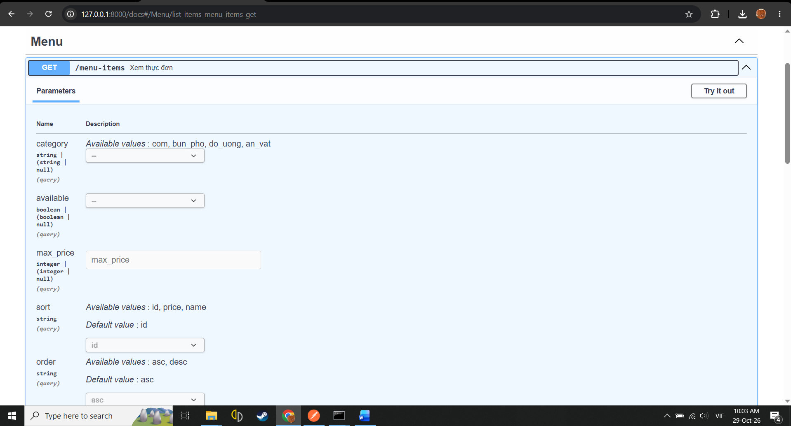
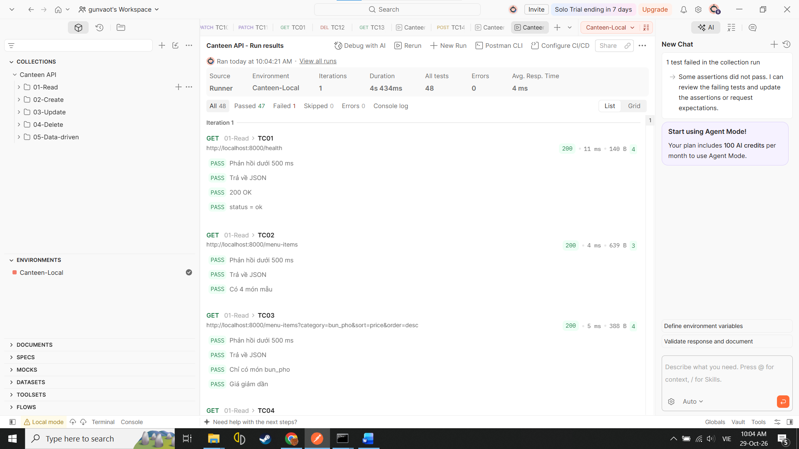
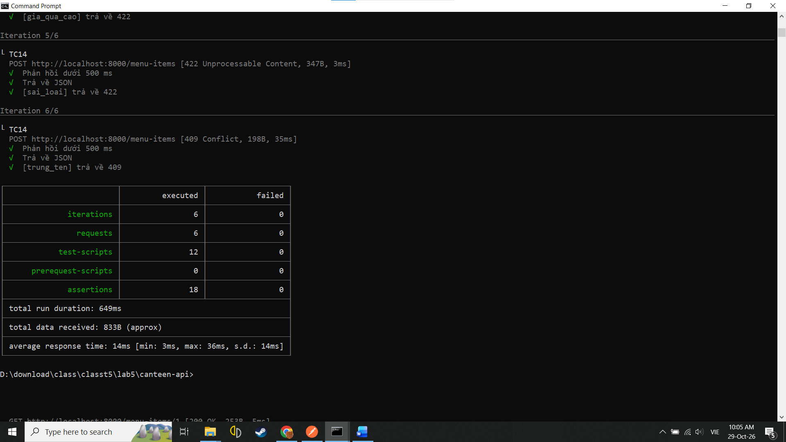

# Canteen API

API quản lý thực đơn căng tin (CRUD) viết bằng **FastAPI**, kiểm thử bằng **Postman** và **Newman**.

Chi tiết thiết kế (trường dữ liệu, endpoint, mã lỗi) xem tại [docs/design.md](docs/design.md).

## Yêu cầu

- Python 3.10 trở lên
- Node.js LTS (chỉ cần khi chạy Newman)
- Postman Desktop (tùy chọn)

## Cài đặt và chạy (Windows, CMD)

```
cd canteen-api
python -m venv .venv
.venv\Scripts\activate
pip install -r requirements.txt
python -m uvicorn app.main:app --reload
```

Sau khi chạy:

- Trang tài liệu Swagger: http://127.0.0.1:8000/docs
- Kiểm tra server: http://127.0.0.1:8000/health

Dữ liệu lưu trong bộ nhớ. Mỗi lần khởi động lại server, dữ liệu về lại 4 món mẫu.

## Cấu trúc thư mục

```
canteen-api/
├── app/
│   ├── main.py          # Khởi tạo ứng dụng, /health
│   ├── schemas.py       # Mô hình dữ liệu (Pydantic) và ràng buộc
│   ├── repository.py    # Lưu trữ trong bộ nhớ + dữ liệu mẫu
│   └── routers/menu.py  # 6 endpoint của /menu-items
├── postman/
│   ├── Canteen-API.postman_collection.json
│   ├── Canteen-Local.postman_environment.json
│   └── negative.csv     # Dữ liệu cho kiểm thử trường hợp lỗi
├── docs/                # Thiết kế và ảnh minh họa
└── requirements.txt
```

## Kiểm thử

### Postman

1. Import `postman/Canteen-API.postman_collection.json` và `postman/Canteen-Local.postman_environment.json`.
2. Chọn environment `Canteen-Local`, bật server.
3. Chạy Collection Runner (bỏ thư mục `05-Data-driven`). Với thư mục này, chọn file `postman/negative.csv` ở mục Iteration data.

### Newman (dòng lệnh)

Khởi động lại server trước mỗi lần chạy để dữ liệu sạch.

Lần 1: bốn thư mục CRUD (13 request):

```
npx newman run postman/Canteen-API.postman_collection.json -e postman/Canteen-Local.postman_environment.json --folder 01-Read --folder 02-Create --folder 03-Update --folder 04-Delete
```

Lần 2: kiểm thử theo dữ liệu CSV (6 trường hợp lỗi):

```
npx newman run postman/Canteen-API.postman_collection.json -e postman/Canteen-Local.postman_environment.json --folder 05-Data-driven -d postman/negative.csv
```

## Kết quả

| Công cụ | Kết quả |
|---|---|
| Postman Runner (13 request) | 45 test, 0 lỗi |
| Newman, CRUD (13 request) | 45 assertion, 0 lỗi |
| Newman, data-driven (6 vòng) | 18 assertion, 0 lỗi |

### Swagger



### Postman Runner



### Newman


